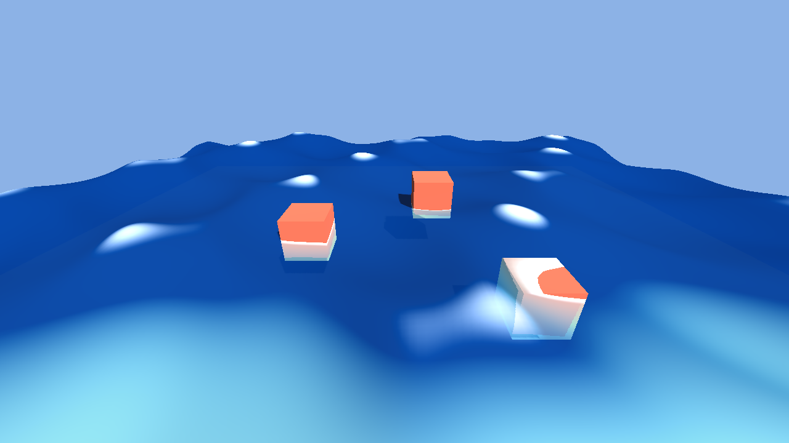

# Финальный тест: агент пишет шейдер воды, Godot проверяет и рендерит

Цель — проверить всю цепочку «усиленной» системы на реальной задаче GameDev:
агент CodeWhale пишет `.gdshader` с волнами Герстнера, проверяет его через инструмент
`godot_check` MCP-сервера `ai-drive` (встроен в CodeWhale Desktop), и Godot рендерит сцену.

## Что проверено автоматически (2026-10-16, Linux-контейнер)

Скрипт `codewhale-desktop/e2e/fixtures/live/final_test_water.py` поднимает настоящий
`codewhale app-server`, регистрирует `ai-drive` в `mcp.json` (так же, как это делает кнопка
«Подключить MCP» в приложении) и ведёт один ход агента. Единственная подмена — текст модели:
реестр Ollama из контейнера недоступен, поэтому ответы даёт сценарный `mock_ollama.py`
(сценарий `[shader]`). CodeWhale, исполнение инструментов, MCP-транспорт, наш сервер и Godot
настоящие.

| Шаг | Результат |
| --- | --- |
| Агент вызывает `write` → `water.gdshader` (4 036 байт) записан в проект | ✅ (с подтверждением через `POST /v1/approvals/{id}`) |
| Инструменты `ai-drive` отложены → агент вызывает `tool_search("ai-drive godot_check")` | ✅ CodeWhale вернул `mcp_ai-drive_godot_check` и ещё 7 инструментов |
| Агент вызывает `mcp_ai-drive_godot_check` → наш MCP-сервер запускает Godot 4.7.2 headless | ✅ `ok: true`, 11 uniform, ошибок нет |
| Агент сообщает результат пользователю | ✅ «проверка Godot прошла» |
| Независимая проверка тем же инструментом из консоли | ✅ |
| Рендер `Godot/WaterDemo` под Xvfb (OpenGL Compatibility, llvmpipe) в PNG | ✅ `docs/final-test/water.png` |

Отчёт: `docs/final-test/report.json`. Снимок: ниже.



### Что это выявило
- MCP-инструменты CodeWhale **отложенные**: модель должна сначала вызвать `tool_search` с именем
  сервера. Скилл `knowledge-drive` теперь об этом говорит, а в списке модели инструменты
  называются `mcp_ai--drive_*` (дефис в имени сервера удваивается).
- CodeWhale спрашивает подтверждение на каждый вызов пользовательского MCP-инструмента даже с
  `readOnlyHint`. В приложении добавлено правило автоподтверждения **ai-drive** (включено по
  умолчанию), иначе агент останавливался бы на каждом поиске.
- В Compatibility-рендере глубину из `hint_depth_texture` нужно переводить в NDC как
  `depth * 2.0 - 1.0`, иначе вся поверхность читается как «мелководье» (вся в пене). Шейдер
  теперь делает это через `#if CURRENT_RENDERER == RENDERER_COMPATIBILITY`.

## Как повторить у себя (Windows, настоящая модель)

1. Настройте диск знаний и Godot по `docs/KNOWLEDGE_DRIVE.md` (нужны хотя бы: путь к `godot.exe`
   в настройках, «Подключить MCP», «Установить скиллы»). Ollama с моделью с вызовом инструментов
   (например `qwen2.5-coder:7b` с `num_ctx` ≥ 16k).
2. Откройте в приложении проект `Godot/WaterDemo` (папка репозитория) и отправьте:
   > Напиши `water.gdshader` для Godot 4 с тремя волнами Герстнера, пеной на гребнях и
   > френелем, подключи его в `water_material.tres`, проверь шейдер инструментом `godot_check`
   > и исправляй, пока проверка не пройдёт. В конце запиши задачу через `ledger_record`.
3. Ожидаемое поведение: агент загружает скилл `math-physics-godot` (там эталонная функция
   волны), пишет файл, вызывает `tool_search` → `godot_check`, при ошибках правит шейдер и
   повторяет проверку, затем `ledger_record` фиксирует `VERIFIED_OK` в
   `D:\AI_Drive\.agent_state\ledger.json`.
4. Рендер сцены без окна (PowerShell 5.1):
   ```powershell
   & "F:\PROJECTS\godot-hd\engine\bin\godot.windows.editor.x86_64.exe" --path .\Godot\WaterDemo --resolution 1280x720 --quit-after 120 -- --shot D:\water.png
   ```
   или просто откройте проект в редакторе и нажмите F5 — сцена строится скриптом
   `water_demo.gd`.

## Повторить автоматический прогон (Linux/WSL)

```bash
python3 codewhale-desktop/e2e/fixtures/live/final_test_water.py \
  --codewhale <путь к codewhale> --desktop <путь к codewhale-desktop> \
  --godot <путь к Godot 4.x> --project Godot/WaterDemo --shader Godot/WaterDemo/water.gdshader \
  --check-project codewhale-desktop/src-tauri/resources/godot-check --out /tmp/final --render
```
Нужны `xvfb-run` и Mesa для `--render`; без `--render` достаточно headless Godot.
